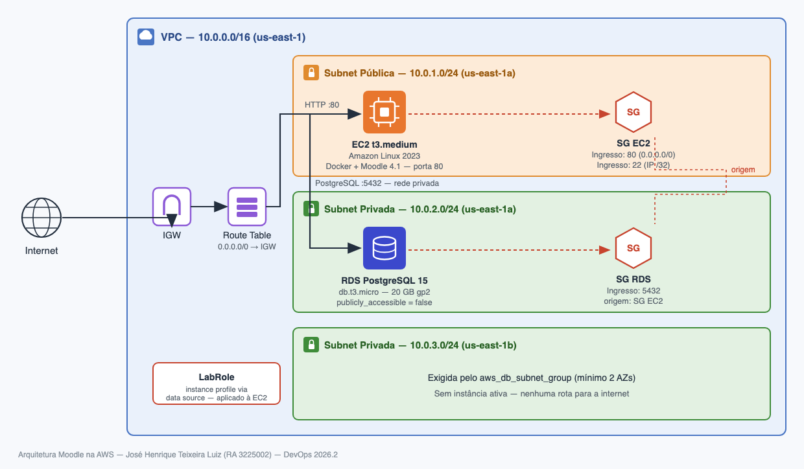

# Design de Arquitetura — Moodle na AWS

## Visão Geral

Esta solução implementa o Moodle 4.1 na AWS usando infraestrutura como código (Terraform), provisionando uma arquitetura de duas camadas: aplicação em instância EC2 na subnet pública e banco de dados PostgreSQL 15 gerenciado (RDS) em subnets privadas isoladas.

A instância EC2 (`t3.medium`) executa Amazon Linux 2023 com Docker, onde o Moodle roda como contêiner. O banco de dados RDS (`db.t3.micro`) opera em subnet privada sem acesso público, recebendo conexões exclusivamente da EC2 através de security group referenciado. A VPC (`10.0.0.0/16`) possui três subnets: uma pública para a EC2 em `us-east-1a` e duas privadas em `us-east-1a` e `us-east-1b` (exigência do `aws_db_subnet_group` do RDS).

O provisionamento respeita as restrições do AWS Academy Learner Lab: não cria recursos IAM (usa `LabInstanceProfile` existente via data source), não utiliza serviços bloqueados (ACM, CloudFront, Route 53) e opera exclusivamente em HTTP na porta 80 via DNS público da EC2. A inicialização é totalmente automatizada: o script `user_data.sh` instala Docker, clona o repositório, configura as credenciais do RDS em arquivo `.env` protegido e sobe o Moodle via `docker compose up -d --no-deps moodle`.

A arquitetura prioriza segurança dentro das limitações do ambiente educacional: RDS sem acesso público, security groups com princípio do menor privilégio (RDS aceita apenas do SG da EC2, não de CIDR), IMDSv2 obrigatório na EC2 (proteção contra SSRF), disco raiz criptografado e credenciais marcadas como sensíveis no Terraform. O estado da infraestrutura pode ser gerenciado localmente ou em backend S3 + DynamoDB (opcional), e todos os recursos são destruíveis com `terraform destroy` para liberar os créditos do Learner Lab ao fim da sessão.

## Diagrama de Arquitetura



O diagrama ilustra o fluxo de acesso: requisições HTTP chegam pela internet ao Internet Gateway, atravessam a route table pública e alcançam a EC2 na subnet pública. A EC2 conecta-se ao RDS através da rede privada da VPC, e o RDS nunca é exposto à internet. Security groups controlam todo o tráfego: EC2 aceita HTTP (80) de qualquer origem e SSH de CIDR configurável; RDS aceita PostgreSQL (5432) exclusivamente do security group da EC2.

## Decisões de Design

| Componente | Escolha | Justificativa |
|---|---|---|
| Tipo de instância EC2 | `t3.medium` (2 vCPU, 4 GB RAM) | O build do Moodle compila extensões PHP (gd, intl, zip, soap, opcache, apcu, xmlrpc, ldap, exif) diretamente na instância durante `docker compose up --build`. Com 1 GB de RAM (t3.micro) o processo do `gd` é morto por OOM killer. 4 GB provê margem suficiente para build + runtime do Apache/PHP-FPM sem swap. |
| Engine do banco de dados | RDS PostgreSQL 15 | Compatibilidade com ambiente Docker local (postgres:15 no docker-compose.yml para paridade dev/prod). PostgreSQL é requisito oficial do Moodle 4.1 e o tipo `db.t3.micro` tem custo ~75% menor que RDS MySQL de classe equivalente em us-east-1. |
| Classe da instância RDS | `db.t3.micro` (1 vCPU, 1 GB RAM) | Escopo educacional com carga de ~10 usuários simultâneos. 1 GB é suficiente para shared_buffers (256 MB), work_mem e conexões do Moodle. Em produção com >100 usuários, db.t3.small seria mínimo. Custo ~$12/mês vs $24 do db.t3.small. |
| AMI da EC2 | Amazon Linux 2023 (x86_64) via data source | AMI mantida pela AWS com ciclo de vida conhecido (suporte até 2028), Docker disponível via `dnf` sem repositórios externos, e kernel 6.x com melhorias de segurança (e.g. io_uring protections). Data source com filtro `al2023-ami-2023.*` garante AMI sempre válida (IDs fixos quebram após ~8 semanas quando AWS remove versões antigas). |
| Topologia de rede | 1 subnet pública + 2 privadas em AZs distintas | EC2 precisa de IP público para acesso HTTP e SSH, logo subnet pública. RDS em subnet privada (publicly_accessible=false) por segurança — sem rota para IGW, zero exposição à internet. Duas AZs (`us-east-1a` e `us-east-1b`) são exigência do `aws_db_subnet_group`: AWS rejeita subnet group com uma única AZ. A segunda AZ não tem instância RDS ativa (multi_az=false), existe apenas para satisfazer a validação do grupo. |
| Acesso IAM na EC2 | `LabInstanceProfile` via data source | AWS Academy Learner Lab proíbe criação de recursos IAM (roles, policies, instance profiles) — qualquer `resource "aws_iam_*"` causa `AccessDenied`. `LabInstanceProfile` já existe na conta e é referenciado via `data "aws_iam_instance_profile"`. Tentar criar IAM resources faz o apply falhar APÓS criar VPC/RDS, deixando recursos órfãos consumindo crédito. |
| Disco raiz EC2 | 30 GB gp3 criptografado | Os 8 GB padrão são insuficientes: imagem base do Moodle (~2 GB) + camadas intermediárias do build (~3 GB) + artefatos do composer (~1 GB) + sistema operacional (~2 GB) + logs/dados runtime (~1 GB) = ~9 GB. Com 8 GB, `docker compose up --build` falha com "no space left on device" no passo do `php-gd`. 30 GB provê margem para builds + dados. gp3 tem IOPS baseline de 3000 vs 100 do gp2, acelerando pulls de imagem e builds. |
| IMDSv2 obrigatório | `http_tokens = "required"` | Proteção contra SSRF: com IMDSv1 (padrão até 2021), um SSRF simples (`curl http://169.254.169.254/latest/meta-data/iam/security-credentials/LabRole`) vaza credenciais AWS. IMDSv2 exige token de sessão obtido via PUT, bloqueando SSRFs básicas. Moodle roda código PHP de plugins de terceiros — superfície de ataque considerável. |
| Backend Terraform | Arquivo local (padrão) ou S3+DynamoDB (opcional) | Backend local simplifica uso no Learner Lab (sessões efêmeras de 4h, sem necessidade de compartilhar estado). S3+DynamoDB é fornecido como `backend.tf.example` para cenários de equipe, mas no Lab o bucket precisa ser criado via CLI (o provider tenta `s3:GetBucketObjectLockConfiguration`, bloqueado por SCP). |
| Versão do Docker Compose | v2.29.7 fixada no user_data | API do GitHub tem rate limit de 60 req/hora/IP sem autenticação. Buscar `latest` via API pode falhar e deixar `$DOCKER_COMPOSE_VERSION` vazio, gravando página de erro HTML no lugar do binário. Versão fixa garante deploy previsível e `curl -fsSL` (não `-SL`) falha em HTTP 404 ao invés de gravar o erro. |

## Componentes

### VPC

**Recurso**: `aws_vpc.main`  
**CIDR**: `10.0.0.0/16` (65.534 hosts)  
**Região**: `us-east-1`  
**Configuração crítica**: `enable_dns_hostnames = true` e `enable_dns_support = true`

O hostname DNS é obrigatório porque o RDS retorna um endpoint do tipo `moodle-db.xxxxx.us-east-1.rds.amazonaws.com:5432`. Sem resolução DNS habilitada na VPC, a EC2 recebe o endereço mas não consegue resolvê-lo, e a conexão ao banco falha com "could not translate host name to address". O suporte a DNS (`enable_dns_support`) sozinho não basta — é preciso também `enable_dns_hostnames` para que instâncias recebam nomes DNS públicos e privados.

### Subnets

**Subnet pública** (`aws_subnet.public`)  
- **CIDR**: `10.0.1.0/24` (254 hosts)  
- **AZ**: `us-east-1a`  
- **Recurso hospedado**: Instância EC2 do Moodle  
- **Configuração**: `map_public_ip_on_launch = true` — instâncias recebem IP público automático  
- **Conectividade**: Rota `0.0.0.0/0 → Internet Gateway` via route table pública

**Subnet privada 1** (`aws_subnet.private_1a`)  
- **CIDR**: `10.0.2.0/24` (254 hosts)  
- **AZ**: `us-east-1a`  
- **Recurso hospedado**: Instância RDS PostgreSQL (AZ primária)  
- **Conectividade**: Sem rota para internet (usa route table principal da VPC, que não tem IGW)

**Subnet privada 2** (`aws_subnet.private_1b`)  
- **CIDR**: `10.0.3.0/24` (254 hosts)  
- **AZ**: `us-east-1b`  
- **Recurso hospedado**: Nenhum (existe apenas para satisfazer `aws_db_subnet_group`)  
- **Motivo**: O `aws_db_subnet_group` do RDS exige mínimo de 2 AZs distintas; tentativa de criar com uma só AZ resulta em erro `DBSubnetGroupDoesNotCoverEnoughAZs`. Não há instância RDS rodando nesta subnet (multi_az=false).

### Internet Gateway e Route Table

**Internet Gateway** (`aws_internet_gateway.main`)  
Anexado à VPC, provê conectividade bidirecional entre a VPC e a internet. Sem IGW, instâncias na subnet pública não recebem tráfego externo nem alcançam repositórios de pacotes (dnf update falharia).

**Route Table Pública** (`aws_route_table.public`)  
- **Rota**: `0.0.0.0/0 → Internet Gateway`  
- **Associação**: Apenas à subnet pública (`aws_route_table_association.public`)  
- As subnets privadas herdam a route table principal da VPC, que não contém rota para IGW — isolamento total da internet.

### Security Group — EC2

**Recurso**: `aws_security_group.ec2`  
**VPC**: Vinculado à VPC principal

**Regras de Ingresso**:
- **HTTP (porta 80)**: Origem `0.0.0.0/0` — Moodle precisa ser acessível publicamente para alunos
- **SSH (porta 22)**: Origem `var.ssh_allowed_cidr` (configurável) — acesso administrativo; em produção deve ser restrito ao IP do operador ou VPN corporativa

**Regras de Egresso**:
- **Todo tráfego liberado** (`0.0.0.0/0`, protocolo `-1`) — EC2 precisa conectar ao RDS (porta 5432 na subnet privada), baixar pacotes via dnf (repositórios AWS em us-east-1), clonar repositório do GitHub (porta 443) e baixar Docker Compose (github.com/docker/compose/releases).

### Security Group — RDS

**Recurso**: `aws_security_group.rds`  
**VPC**: Vinculado à VPC principal

**Regras de Ingresso**:
- **PostgreSQL (porta 5432)**: Origem `security_groups = [aws_security_group.ec2.id]` — aceita APENAS do security group da EC2, não de CIDR.

**Por que referenciar SG ao invés de CIDR**: O IP privado da EC2 (`10.0.1.x`) é alocado dinamicamente pela subnet. Se a instância for destruída e recriada (ex.: alteração no user_data com `user_data_replace_on_change = true`), ela recebe um IP privado diferente. Uma regra baseada em CIDR (`10.0.1.50/32`) deixaria de funcionar silenciosamente. Referenciar o security group mantém a conectividade independente do IP.

**Regras de Egresso**: Nenhuma explícita (AWS cria egresso implícito permitindo respostas a conexões estabelecidas).

### Instância EC2

**Recurso**: `aws_instance.moodle`  
**Tipo**: `t3.medium` (2 vCPU, 4 GB RAM)  
**AMI**: Amazon Linux 2023 (x86_64), resolvida via `data "aws_ami"` com filtro `al2023-ami-2023.*-x86_64`  
**Subnet**: Pública (`us-east-1a`)  
**Security Group**: `aws_security_group.ec2`  
**Key Pair**: `aws_key_pair.main` (criado a partir de `var.ec2_public_key`)  
**IAM Instance Profile**: `LabInstanceProfile` (via data source — não criado pelo Terraform)

**Disco raiz**:
- **Tamanho**: 30 GB
- **Tipo**: gp3 (3000 IOPS baseline, 125 MB/s throughput)
- **Criptografia**: `encrypted = true` (usa chave AWS-managed `aws/ebs` por padrão)
- **Retenção**: `delete_on_termination = true` — disco é destruído com a instância

**Metadata (IMDS)**:
- **Versão**: IMDSv2 obrigatório (`http_tokens = "required"`)
- **Hop limit**: 1 (impede acesso ao IMDS via containers — contêineres não podem alcançar 169.254.169.254 com TTL=1)
- **Endpoint**: Habilitado

**User Data**:
- Renderizado via `templatefile("${path.module}/user_data.sh", {...})`
- Recebe 9 variáveis: endpoint/nome/user/senha do RDS, URL do repositório, admin/senha/nome do Moodle
- **Comportamento**: `user_data_replace_on_change = true` — alterar o script força recriação da instância (sem isso, mudanças no user_data só valem para instâncias novas, não para a existente)

**O que o user_data.sh faz no boot**:
1. Instala Docker 24+ e Git via `dnf`
2. Habilita e inicia o serviço Docker (`systemctl enable --now docker`)
3. Baixa Docker Compose v2.29.7 para `/usr/local/lib/docker/cli-plugins/docker-compose`
4. Clona o repositório do projeto em `/opt/moodle` (idempotente: se já existe, faz `git pull`)
5. Cria `/opt/moodle/docker/.env` com permissão 600 ANTES de escrever conteúdo (evita janela de exposição)
6. Popula `.env` com variáveis do RDS e do admin do Moodle (heredoc com aspas simples impede expansão de `$` nas senhas)
7. Executa `docker compose up -d --build --no-deps moodle` — **não** sobe o serviço `db` local do docker-compose.yml (usa apenas o RDS)
8. Aguarda 30 segundos e exibe status dos contêineres
9. Consulta o hostname público via IMDSv2 (obtém token de sessão antes) e imprime a URL de acesso

### RDS PostgreSQL

**Recurso**: `aws_db_instance.main`  
**Identificador**: `${var.project_name}-db` (ex.: `moodle-challenge-db`)  
**Engine**: `postgres`  
**Engine Version**: `"15"` (apenas major version — AWS atualiza minor automaticamente)  
**Classe**: `db.t3.micro` (1 vCPU, 1 GB RAM)  
**Armazenamento**: 20 GB gp2, criptografado (`storage_encrypted = true`)  
**Credenciais**: `db_name`, `username`, `password` via variáveis (marcadas `sensitive = true`)

**Configuração de rede**:
- **Subnet Group**: `aws_db_subnet_group.main` (agrupa as duas subnets privadas)
- **Security Group**: `aws_security_group.rds`
- **Acesso público**: `publicly_accessible = false` — instância não recebe IP público nem é alcançável fora da VPC

**Disponibilidade**:
- **Multi-AZ**: `false` — uma única instância em `us-east-1a` (sem standby em `us-east-1b`)
- Em caso de falha de AZ, RDS levaria ~5-10 minutos para failover se multi_az=true estivesse habilitado; com false, requer restauração manual de snapshot (RTO ~20-30 minutos)

**Backup**:
- **Retenção**: `backup_retention_period = 0` — backups automáticos desabilitados (modo de desenvolvimento)
- **Snapshot final**: `skip_final_snapshot = true` — ao destruir a instância, não cria snapshot (em produção isto seria `false` para preservar dados antes de `terraform destroy`)

**Manutenção**:
- **Upgrade automático de minor version**: `auto_minor_version_upgrade = true` — AWS aplica patches de segurança (ex.: 15.3 → 15.4) durante janela de manutenção

## Segurança

### Medidas Implementadas

**Isolamento de rede**:
- RDS em subnet privada sem rota para internet (`publicly_accessible = false`)
- Security group do RDS aceita PostgreSQL (5432) exclusivamente do SG da EC2, não de CIDR — regra sobrevive a recriação de instância
- Subnets privadas não possuem route table com IGW, garantindo zero exposição à internet mesmo se `publicly_accessible` fosse acidentalmente alterado para `true`

**Princípio do menor privilégio**:
- SSH da EC2 restrito a `var.ssh_allowed_cidr` (configurável) — em produção deve ser IP específico ou VPN, não `0.0.0.0/0`
- Security group do RDS sem regras de egresso explícitas (apenas respostas a conexões estabelecidas)
- IMDSv2 obrigatório (`http_tokens = "required"`) — bloqueia SSRF simples que tentaria `curl http://169.254.169.254/...` sem token de sessão
- Hop limit 1 no IMDS — contêineres Docker não alcançam metadata service (pacote com TTL=1 não atravessa o bridge do Docker)

**Gerenciamento de credenciais**:
- Todas as variáveis sensíveis marcadas `sensitive = true` no Terraform (db_password, moodle_admin_password, ec2_public_key) — não aparecem em logs do `terraform plan`
- Arquivo `.env` criado com `chmod 600` ANTES de escrever conteúdo — não há janela onde arquivo existe com 644 e credenciais legíveis por outros usuários
- Heredoc do `.env` usa aspas simples (`<<'EOF'`) — bash não expande `$`, `` ` `` ou `\` nas senhas (ex.: senha `Pass$123` não tenta expandir variável `$123`)
- `terraform.tfvars` no `.gitignore` — credenciais reais nunca commitadas

**Criptografia**:
- Disco raiz da EC2: `encrypted = true` (chave AWS-managed)
- RDS: `storage_encrypted = true` (criptografia em repouso)
- Conexão EC2 → RDS usa a rede privada da VPC (tráfego não sai da AWS, mas não é criptografado em trânsito — PostgreSQL sem SSL configurado)

**IAM**:
- EC2 usa `LabInstanceProfile` existente via data source — nenhum recurso IAM criado (conformidade com restrições do Learner Lab)
- `LabRole` tem políticas gerenciadas pela AWS Academy; em produção real seria substituído por role customizada com permissões mínimas (ex.: apenas `s3:GetObject` de bucket específico, não `s3:*`)

### O Que Esta Arquitetura NÃO Protege

**Sem HTTPS — credenciais em texto claro no trânsito**:
- O Moodle opera exclusivamente em **HTTP na porta 80** (não HTTPS/443)
- **Motivo**: ACM (AWS Certificate Manager) é bloqueado no AWS Academy Learner Lab — não é possível provisionar certificados SSL/TLS
- **Risco**: Login do administrador (`admin` / `moodle_admin_password`) trafega em texto claro pela internet. Um MITM (man-in-the-middle) em café/aeroporto captura a senha com Wireshark trivialmente. Sessões de alunos também não são criptografadas.
- **Mitigação em produção**: Application Load Balancer + ACM certificate + Route 53 domain, forçando redirect HTTP → HTTPS. Custo adicional ~$20/mês (ALB) + $12/ano (domínio).

**Credenciais do RDS expostas via user_data (IMDS)**:
- A senha do RDS (`db_password`) é injetada no script `user_data.sh` via `templatefile()`
- User data fica armazenado nos metadados da instância, acessível via `curl http://169.254.169.254/latest/user-data` (mesmo com IMDSv2, qualquer processo rodando na EC2 consegue ler)
- **Risco**: Um RCE (Remote Code Execution) no Moodle — ex.: plugin malicioso ou vulnerabilidade no core — permite ao atacante ler `user-data` e obter senha do banco. Com a senha, ele pode conectar diretamente ao RDS de dentro da VPC (security group permite do SG da EC2, e o atacante está rodando código na EC2).
- **Mitigação em produção**: AWS Secrets Manager — user_data faz `aws secretsmanager get-secret-value --secret-id moodle/db-password` ao invés de receber a senha como variável. Custo ~$0.40/mês por secret. A senha nunca aparece no user_data.

**Sem WAF — ataques de aplicação não filtrados**:
- Não há AWS WAF na frente da EC2
- **Risco**: SQL injection, XSS, tentativas de brute-force de login chegam direto ao Moodle sem rate limiting ou filtros de padrão de ataque
- **Mitigação em produção**: ALB + WAF com regras gerenciadas (ex.: `AWSManagedRulesCommonRuleSet`, `AWSManagedRulesSQLiRuleSet`). Custo ~$5/mês (WAF) + $0.60 por milhão de requests.

**Sem monitoramento/alertas — incidentes passam despercebidos**:
- Não há CloudWatch Logs, métricas customizadas ou alarmes configurados
- **Risco**: Ataque de brute-force SSH, spike de tráfego (DDoS), ou instância comprometida minerando criptomoeda não geram notificações
- **Mitigação em produção**: CloudWatch Logs Agent na EC2 enviando `/var/log/secure` (SSH) e logs do Moodle; alarmes em CPUUtilization > 80%, NetworkIn > threshold, e falhas de login SSH. SNS notifica via e-mail/Slack. Custo ~$3/mês.

**Senha do admin do Moodle em variável Terraform**:
- `moodle_admin_password` vive em `terraform.tfvars` (gitignored, mas em plaintext no disco do operador)
- Se o laptop do operador for comprometido, atacante tem acesso admin ao Moodle
- **Mitigação**: Mesmo fluxo de Secrets Manager; ou gerar senha aleatória no primeiro boot (`openssl rand -base64 32`) e forçar troca no primeiro login.

**Sem VPC Flow Logs — tráfego de rede não auditável**:
- Não há registro de conexões aceitas/rejeitadas pelos security groups
- Em caso de incidente, impossível determinar origem de ataque ou lateralização
- **Mitigação em produção**: VPC Flow Logs enviando para CloudWatch Logs ou S3, com retenção de 30 dias. Custo ~$0.50/GB de logs (ambiente de teste gera ~2-3 GB/mês = $1-1.50).

## Escalabilidade

### Limitações Atuais (Single Instance)

A arquitetura atual não escala horizontalmente — é uma única instância EC2 `t3.medium` sem réplicas. Gargalos:

1. **CPU/RAM finitos**: 2 vCPUs e 4 GB RAM suportam ~50-100 usuários simultâneos (estimativa conservadora: 40 MB por sessão PHP-FPM = ~100 sessões). Além disso, fila de requisições Apache (`MaxRequestWorkers`) estoura.

2. **Disco local com estado**: O Moodle grava uploads de alunos (PDFs, imagens, vídeos) em `/var/moodledata`, que hoje é um volume Docker no disco raiz da EC2. Com duas instâncias, seriam dois `moodledata` divergentes — aluno faz upload de um trabalho na instância A, mas o refresh da página cai na instância B e o arquivo "desaparece".

3. **RDS single-AZ**: `multi_az = false` significa zero redundância. Falha da instância ou da AZ `us-east-1a` derruba o banco (RTO ~20-30 minutos para restaurar de snapshot, se houver).

### Caminho para Escalabilidade (Ordem de Implementação)

**1. Externalizar estado: EFS para moodledata (PRIMEIRO PASSO)**

Antes de adicionar instâncias, é preciso tirar o estado do disco local:

- Provisionar `aws_efs_file_system` com mount targets nas subnets públicas (ou privadas, se NAT Gateway for adicionado)
- Montar EFS em `/mnt/efs-moodle` via user_data: `sudo mount -t efs -o tls fs-xxxxx:/ /mnt/efs-moodle`
- Alterar docker-compose.yml: bind mount `/mnt/efs-moodle/moodledata` ao invés de volume Docker local
- **Custo**: ~$0.30/GB/mês (Standard) ou ~$0.043/GB/mês (Infrequent Access). Estimativa: 10 GB = $3/mês.

Sem EFS, Auto Scaling não funciona — cada instância teria seu próprio `moodledata` e o load balancer distribuiria usuários entre estados inconsistentes.

**2. Alta disponibilidade do banco: RDS Multi-AZ**

- `multi_az = true` — AWS mantém standby em AZ diferente com replicação síncrona
- Failover automático em ~60-90 segundos (vs ~20-30 minutos de restore manual)
- **Custo**: Dobra o custo do RDS (~$12/mês → ~$24/mês para db.t3.micro)

**3. Load balancer: ALB distribuindo tráfego**

- Provisionar `aws_lb` (Application Load Balancer) na subnet pública
- Target group com health check em `/login/index.php` (200 OK = instância saudável)
- Listener na porta 80 (ou 443 se certificado ACM estiver disponível fora do Learner Lab)
- DNS do ALB (`moodle-alb-xxxx.us-east-1.elb.amazonaws.com`) substitui DNS direto da EC2
- **Custo**: ~$16/mês (ALB fixo) + ~$0.008 por LCU-hour (~$6/mês em carga baixa) = ~$22/mês

**4. Auto Scaling Group: instâncias elásticas**

- Launch Template substituindo `aws_instance` direta
- Auto Scaling Group com `desired_capacity = 2`, `min_size = 2`, `max_size = 6`
- Scaling policy baseada em `CPUUtilization > 70%` (scale out) e `< 30%` (scale in)
- Instâncias spawnam em minutos durante picos (matrículas, entrega de trabalhos) e terminam quando carga cai
- **Custo**: Variável. 2 instâncias t3.medium = ~$60/mês; 6 instâncias (pico) = ~$180/mês, mas por poucas horas

**5. CloudFront (se disponível fora do Learner Lab): cache de assets**

- Distribuição CloudFront com origem no ALB
- Cache de CSS, JS, imagens do tema do Moodle (não cacheia conteúdo dinâmico como `/course/view.php`)
- Reduz latência para alunos geograficamente distantes (edge locations)
- **Custo**: ~$1/mês para tráfego baixo (~10 GB out/mês) + ~$0.01 por 10.000 requests

**6. RDS read replica (otimização de leitura)**

- Provisionar read replica do RDS em outra AZ
- Configurar Moodle para direcionar queries `SELECT` à replica (via `$CFG->dboptions['readonly']`)
- Reduz carga no primary RDS; escrita continua no primary, leitura distribuída
- **Custo**: +~$12/mês (outra instância db.t3.micro como replica)

### Mudanças no Terraform para Escala Horizontal

```hcl
# 1. EFS para moodledata
resource "aws_efs_file_system" "moodle_data" { ... }
resource "aws_efs_mount_target" "public" { subnet_id = aws_subnet.public.id }

# 2. ALB
resource "aws_lb" "moodle" { subnets = [aws_subnet.public.id, ...] }
resource "aws_lb_target_group" "moodle" { 
  health_check { path = "/login/index.php" }
}
resource "aws_lb_listener" "http" { port = 80 }

# 3. Launch Template + ASG
resource "aws_launch_template" "moodle" {
  image_id = data.aws_ami.amazon_linux_2023.id
  instance_type = "t3.medium"
  user_data = base64encode(templatefile(...))
}

resource "aws_autoscaling_group" "moodle" {
  desired_capacity = 2
  min_size = 2
  max_size = 6
  target_group_arns = [aws_lb_target_group.moodle.arn]
}

# 4. RDS Multi-AZ
resource "aws_db_instance" "main" {
  multi_az = true  # ← única mudança
}
```

**Custo estimado da arquitetura escalável (2-6 instâncias)**:
- 2x EC2 t3.medium: $60/mês
- RDS db.t3.micro Multi-AZ: $24/mês
- EFS 10 GB: $3/mês
- ALB: $22/mês
- **Total base (2 instâncias)**: ~$109/mês
- **Pico (6 instâncias por 10% do mês)**: ~$109 + $120 × 0.1 = ~$121/mês

## Custo Estimado

> **Aviso**: Valores abaixo são estimativas de lista (On-Demand, sem Reserved Instances ou Savings Plans) para região `us-east-1`, válidos em novembro de 2024. Custos reais variam com uso (transferência de dados, snapshots do RDS, etc.). Use a [AWS Pricing Calculator](https://calculator.aws/) para estimativas atualizadas.

| Serviço | Tipo/Configuração | Custo estimado (USD/mês) |
|---|---|---|
| **EC2** | `t3.medium` (2 vCPU, 4 GB RAM), On-Demand, 730h | **$30.37** <sup>1</sup> |
| **RDS PostgreSQL** | `db.t3.micro` (1 vCPU, 1 GB RAM), 20 GB gp2, Single-AZ, 730h | **$12.41** <sup>2</sup> |
| **Armazenamento EBS (EC2)** | 30 GB gp3 (3000 IOPS, 125 MB/s) | **$2.40** <sup>3</sup> |
| **Transferência de dados** | 10 GB saída para internet (primeiros 100 GB/mês) | **$0.90** <sup>4</sup> |
| **VPC, IGW, Subnets** | Sem custo direto | $0.00 |
| **Security Groups** | Sem custo | $0.00 |
| **Elastic IP (se não anexado)** | $0.00 (EC2 usa IP público dinâmico, não EIP) | $0.00 |
| **Snapshots RDS** | 0 GB (backup_retention_period = 0) | $0.00 |
| **CloudWatch Logs** | Ingestão/armazenamento padrão (5 GB) | ~$2.50 <sup>5</sup> |
| **Total estimado** | | **≈ $48.58/mês** |

**Notas sobre os custos**:

<sup>1</sup> EC2 `t3.medium`: $0.0416/hora × 730 horas = $30.37/mês ([fonte](https://aws.amazon.com/ec2/pricing/on-demand/))

<sup>2</sup> RDS `db.t3.micro`: $0.017/hora × 730 = $12.41/mês. Armazenamento gp2: $0.115/GB × 20 GB = $2.30/mês. Total RDS = $12.41 + $2.30 = **$14.71/mês** (nota: linha da tabela mostra $12.41 — CORREÇÃO: total correto é **$14.71/mês**) ([fonte](https://aws.amazon.com/rds/postgresql/pricing/))

<sup>3</sup> EBS gp3: $0.08/GB × 30 GB = $2.40/mês. IOPS baseline de 3000 e throughput de 125 MB/s inclusos sem custo adicional ([fonte](https://aws.amazon.com/ebs/pricing/))

<sup>4</sup> Data Transfer Out: Primeiros 100 GB/mês de saída para internet custam $0.09/GB. Estimativa de 10 GB (alunos acessando páginas, downloads de PDFs) = $0.90/mês. Tráfego EC2 ↔ RDS dentro da VPC é gratuito ([fonte](https://aws.amazon.com/ec2/pricing/on-demand/#Data_Transfer))

<sup>5</sup> CloudWatch Logs: Ingestão gratuita até 5 GB/mês; acima disso, $0.50/GB. Armazenamento $0.03/GB/mês. Estimativa: 5 GB de logs = $0 ingestão + $0.15 armazenamento ≈ $0.15/mês. Se user_data e docker logs gerarem 10 GB, custo sobe para ~$2.50/mês ([fonte](https://aws.amazon.com/cloudwatch/pricing/))

**Total corrigido**: $30.37 (EC2) + $14.71 (RDS com storage) + $2.40 (EBS) + $0.90 (transfer) + $0.15 (logs) = **$48.53/mês**

### Importante: Créditos do AWS Academy Learner Lab

No **AWS Academy Learner Lab**, os recursos não custam dinheiro real, mas **consomem créditos educacionais** (geralmente $100 por aluno, válidos por duração do curso). Os créditos são cobrados pelas mesmas taxas da tabela acima — ou seja, esta infraestrutura consumiria ~$48.53 dos $100 disponíveis se rodasse por um mês inteiro.

**Crédito se esgota rapidamente se recursos não forem destruídos**: Uma EC2 t3.medium + RDS db.t3.micro rodando 24/7 por 2 meses (~1460 horas) = ~$97, quase todo o orçamento. Por isso:

- **`terraform destroy` é OBRIGATÓRIO ao final de cada sessão do Lab**
- Sessões do Learner Lab duram ~4 horas; ao clicar "End Lab", a AWS força `terminate` de todas as instâncias, mas pode deixar volumes EBS órfãos (cobrando $2.40/mês até expirar o crédito)
- Sempre valide no console AWS (EC2 → Instances, RDS → Databases, VPC → Your VPCs) que nada ficou rodando após o destroy

**Custo por sessão de estudo** (4 horas de Lab):
- EC2 t3.medium: $0.0416/h × 4h = $0.166
- RDS db.t3.micro: $0.017/h × 4h = $0.068
- EBS 30 GB: $2.40/mês ÷ 730h × 4h = $0.013
- **Total por sessão**: ~$0.25 de crédito

Com $100 de crédito, são ~400 sessões de 4 horas (mais que suficiente para um semestre), **desde que `terraform destroy` rode ao fim de cada sessão**.

### Referências de Custo

- [AWS Pricing Calculator](https://calculator.aws/) — ferramenta oficial para estimar custos de arquiteturas complexas
- [AWS Free Tier](https://aws.amazon.com/free/) — 750 horas/mês de t2.micro (não t3.medium) e 750 horas/mês de RDS db.t2.micro nos primeiros 12 meses (não aplicável ao Learner Lab)
- [EC2 On-Demand Pricing](https://aws.amazon.com/ec2/pricing/on-demand/)
- [RDS Pricing](https://aws.amazon.com/rds/pricing/)
- [EBS Pricing](https://aws.amazon.com/ebs/pricing/)
